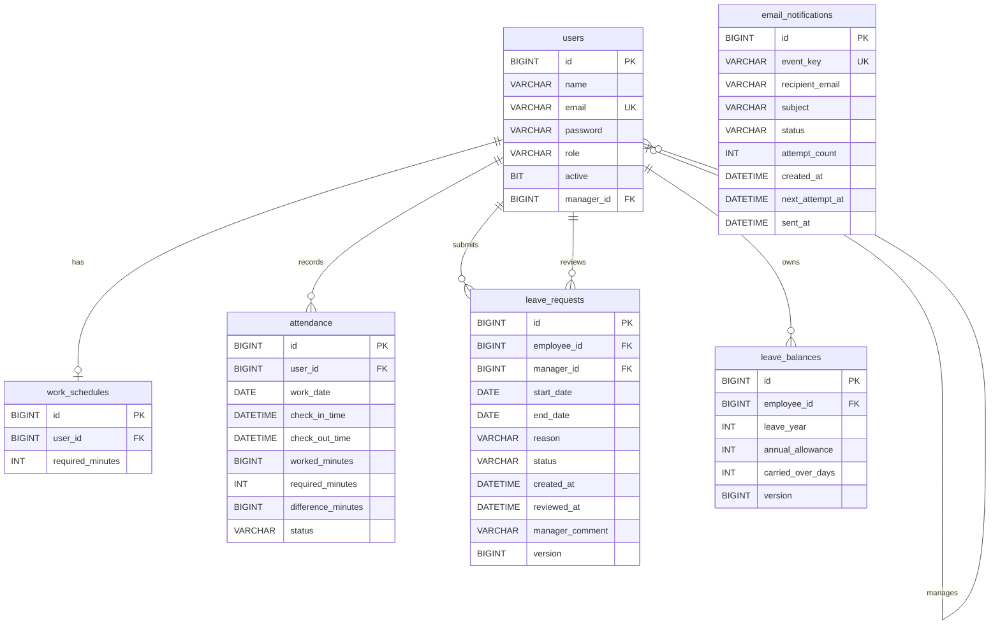

# Employee Attendance Management System

A backend-only Employee Attendance Management System built with **Java 21**, **Spring Boot 4**, **Spring Security**, and **Microsoft SQL Server**.

The REST API provides JWT authentication, role-based access control, employee attendance tracking, work schedule management, annual leave requests and balances, manager reporting, and reliable email notifications.

The project demonstrates layered API design, database migrations, transactional consistency, concurrency protection, and automated testing.

## Features

### Authentication and authorization

- JWT-based stateless authentication and BCrypt password hashing
- Employee registration and login
- Three roles: `EMPLOYEE`, `MANAGER`, and `ADMIN`
- Role-restricted endpoints and inactive-account protection
- Environment-based database credentials and JWT secret

### Attendance and schedules

- Employee check-in, check-out, and personal attendance history
- Worked-minute calculations against employee work schedules
- `COMPLETED` and `INCOMPLETE` attendance status
- Transactional locking to protect concurrent check-in and check-out
- SQL Server filtered unique index to prevent duplicate open attendance sessions
- Administrator-managed work schedules
- Notifications to managers about incomplete attendance

### Annual leave

- Employee leave requests and personal request history
- Manager approval and rejection
- Annual allowances, carried-over days, and per-year balances
- Pending leave reservations and balance validation
- Working-day calculation that excludes Saturdays and Sundays
- Cross-year request calculation
- Overlapping-request detection and concurrency protection

### Manager reporting and notifications

- Date-filtered team attendance details and summaries
- Notifications for new leave requests and manager decisions
- Database-backed email outbox with delivery status, retries, and unique event keys
- Mailpit integration for local SMTP testing

### Persistence and testing

- SQL Server, Spring Data JPA, and Hibernate
- Flyway database migrations and schema validation
- Database constraints, indexes, and transactional operations
- **92 passing automated tests** in the most recently verified full test run
- Manual concurrent-request verification against SQL Server

## Technology Stack

| Component | Technology |
| --- | --- |
| Language | Java 21 |
| Backend | Spring Boot 4, Spring Web MVC |
| Security | Spring Security, JWT (JJWT), BCrypt |
| Persistence | Spring Data JPA, Hibernate |
| Database | Microsoft SQL Server |
| Schema migrations | Flyway |
| Email | Spring Mail, Mailpit |
| Build | Maven Wrapper |
| Testing | JUnit, Mockito, MockMvc, Spring Security Test |
| API testing | Postman |
| Development IDE | IntelliJ IDEA |

## Architecture

The application follows a layered backend structure:

```text
HTTP Request
    |
    v
Spring Security / JWT Filter
    |
    v
REST Controller
    |
    v
Service Layer
    |
    v
Spring Data JPA Repository
    |
    v
Microsoft SQL Server
```

Controllers accept and return DTOs. Services implement business rules, calculations, and transaction boundaries. Repositories provide database access.

## Roles and Authorization

**EMPLOYEE:** Log in, check in/out, view personal attendance, submit leave requests, view personal leave requests, and view leave balances.

**MANAGER:** Log in, view pending requests for assigned employees, approve or reject requests, and view team attendance reports and summaries.

**ADMIN:** Log in, assign managers to employees, and create, update, or view employee work schedules.

Spring Security restricts routes by role; services also enforce applicable employee-manager business rules.

## API Endpoints

Local base URL: `http://localhost:8080`

For protected routes, pass the JWT returned by `/api/auth/login`:

```http
Authorization: Bearer <JWT_TOKEN>
```

### Authentication

| Method | Endpoint | Access | Purpose |
| --- | --- | --- | --- |
| POST | `/api/auth/register` | Public | Register an employee |
| POST | `/api/auth/login` | Public | Log in and obtain a JWT |

### Administration

| Method | Endpoint | Access | Purpose |
| --- | --- | --- | --- |
| PUT | `/api/admin/employees/{employeeId}/manager` | ADMIN | Assign an employee's manager |
| POST | `/api/work-schedules` | ADMIN | Create/update a work schedule |
| GET | `/api/work-schedules/user/{userId}` | ADMIN | Get an employee's work schedule |

### Attendance

| Method | Endpoint | Access | Purpose |
| --- | --- | --- | --- |
| POST | `/api/attendance/check-in` | EMPLOYEE, MANAGER, ADMIN | Check in |
| POST | `/api/attendance/check-out` | EMPLOYEE, MANAGER, ADMIN | Check out |
| GET | `/api/attendance/history` | EMPLOYEE, MANAGER, ADMIN | Personal attendance history |

### Leave and balances

| Method | Endpoint | Access | Purpose |
| --- | --- | --- | --- |
| POST | `/api/leave-requests` | EMPLOYEE* | Submit a leave request |
| GET | `/api/leave-requests/my` | EMPLOYEE or MANAGER* | Personal leave requests |
| GET | `/api/leave-balances/my?year=2028` | EMPLOYEE | Personal annual leave balance |
| GET | `/api/manager/leave-requests/pending` | MANAGER | Assigned pending requests |
| PUT | `/api/manager/leave-requests/{id}/approve` | MANAGER | Approve request |
| PUT | `/api/manager/leave-requests/{id}/reject` | MANAGER | Reject request |

*The security route permits both employee and manager JWTs for `/api/leave-requests`, but leave creation is further restricted to active `EMPLOYEE` accounts by service-level checks; other operations also apply their business rules.

### Manager attendance reporting

| Method | Endpoint | Access | Purpose |
| --- | --- | --- | --- |
| GET | `/api/manager/attendance?startDate=2026-10-01&endDate=2026-10-31` | MANAGER | Team attendance details |
| GET | `/api/manager/attendance/summary?startDate=2026-10-01&endDate=2026-10-31` | MANAGER | Team attendance summary |

Dates use the ISO format `YYYY-MM-DD`.

## Example API Requests

### Register employee

```http
POST /api/auth/register
Content-Type: application/json
```

```json
{
  "name": "Example Employee",
  "email": "employee@example.com",
  "password": "ExamplePassword123"
}
```

Public registration creates an account with the `EMPLOYEE` role.

### Log in

```http
POST /api/auth/login
Content-Type: application/json
```

```json
{
  "email": "employee@example.com",
  "password": "ExamplePassword123"
}
```

A successful response contains account details, a `token`, and `tokenType: "Bearer"`.

### Assign manager (ADMIN)

```http
PUT /api/admin/employees/2/manager
Authorization: Bearer <ADMIN_JWT_TOKEN>
Content-Type: application/json
```

```json
{
  "managerId": 1
}
```

### Create or update schedule (ADMIN)

```http
POST /api/work-schedules
Authorization: Bearer <ADMIN_JWT_TOKEN>
Content-Type: application/json
```

```json
{
  "userId": 2,
  "requiredMinutes": 480
}
```

### Check in or check out

```http
POST /api/attendance/check-in
Authorization: Bearer <EMPLOYEE_JWT_TOKEN>
```

```http
POST /api/attendance/check-out
Authorization: Bearer <EMPLOYEE_JWT_TOKEN>
```

Neither operation requires a request body.

### Submit annual leave (EMPLOYEE)

```http
POST /api/leave-requests
Authorization: Bearer <EMPLOYEE_JWT_TOKEN>
Content-Type: application/json
```

```json
{
  "startDate": "2028-09-04",
  "endDate": "2028-09-08",
  "reason": "Annual vacation"
}
```

A valid request is created with `PENDING` status and reserves the applicable working days.

### Approve or reject leave (MANAGER)

```http
PUT /api/manager/leave-requests/7/approve
Authorization: Bearer <MANAGER_JWT_TOKEN>
Content-Type: application/json
```

```json
{
  "comment": "Approved"
}
```

Use `/reject` instead of `/approve` to reject a pending request.

### Retrieve personal leave balance (EMPLOYEE)

```http
GET /api/leave-balances/my?year=2028
Authorization: Bearer <EMPLOYEE_JWT_TOKEN>
```

Example response from development testing:

```json
{
  "employeeId": 2,
  "leaveYear": 2028,
  "annualAllowance": 30,
  "carriedOverDays": 0,
  "totalEntitlement": 30,
  "approvedDays": 5,
  "pendingDays": 0,
  "remainingDays": 25
}
```

Actual values vary by employee and year.

## Attendance Calculation

Worked time is calculated on checkout:

```text
workedMinutes = checkOutTime - checkInTime

differenceMinutes = workedMinutes - requiredMinutes
```

If `workedMinutes >= requiredMinutes`, the status is `COMPLETED`; otherwise, it is `INCOMPLETE`.

The calculated values are persisted on the attendance record, so historical results remain unchanged after later work schedule updates.

## Annual Leave Calculation

The development policy currently uses a default annual allowance of **30 working days**. Saturdays and Sundays are excluded; public holidays are not automatically excluded.

Pending and approved requests count against the remaining balance. Rejected and cancelled requests do not count.

```text
totalEntitlement = annualAllowance + carriedOverDays
remainingDays = totalEntitlement - approvedDays - pendingDays
```

Cross-year requests are counted separately for each affected year. Requests that overlap other pending/approved leave or exceed the available balance are rejected.

## Database

The main application schema contains six tables:

| Table | Purpose |
| --- | --- |
| `users` | User accounts, roles, and manager relationships |
| `work_schedules` | Working-minute requirements |
| `attendance` | Check-ins, check-outs, and calculated attendance |
| `leave_requests` | Requests and manager decisions |
| `leave_balances` | Employee leave entitlements by year |
| `email_notifications` | Transactional email notification outbox |

### Database Relationship Diagram

The following diagram documents the foreign-key relationships defined in Flyway's initial schema migration.



A user may have one assigned manager, and a manager may oversee many users. A user has at most one work schedule and may have many attendance records, leave requests, and year-specific balances. Each leave request references both an employee and a manager.

`email_notifications` has no foreign-key relationship to the other application tables; its unique `event_key` identifies the business event for deduplication.

A unique constraint on `(employee_id, leave_year)` prevents duplicate annual balances. Flyway also creates and maintains `flyway_schema_history`, which is not part of the application domain diagram.

### Database Migrations

Flyway migrations live in `src/main/resources/db/migration/`:

```text
V1__initial_schema.sql
V2__prevent_duplicate_open_attendance.sql
```

- V1 creates the initial application schema for a new database.
- V2 adds a filtered unique index, ensuring that each user has at most one attendance row whose `check_out_time` is `NULL`.

The original development database was baselined at version 1; new empty databases execute migrations normally.

Hibernate configuration uses:

```properties
spring.jpa.hibernate.ddl-auto=validate
```

Hibernate verifies the schema instead of changing it automatically. Flyway owns schema migrations.

## Local Setup

### Prerequisites

- Java 21
- Microsoft SQL Server accessible on `localhost:1433`
- Git
- Maven Wrapper (included)
- Mailpit for local email testing
- IntelliJ IDEA or another Java IDE
- Postman for API testing

### Clone repository

```bash
git clone https://github.com/IsamAlbourai/employee-attendance-management-system.git
cd employee-attendance-management-system
```

### Create the database

Connect to SQL Server and create the empty database:

```sql
IF DB_ID(N'AttendanceDB') IS NULL
BEGIN
    CREATE DATABASE AttendanceDB;
END;
```

For a **new empty database**, allow Flyway to create the tables on startup. Do not manually execute the V1 migration against an already populated database.

### Set environment variables

Provide `DB_USERNAME`, `DB_PASSWORD`, and `JWT_SECRET`. For example, in Windows PowerShell:

```powershell
$env:DB_USERNAME="YOUR_DATABASE_USERNAME"
$env:DB_PASSWORD="YOUR_DATABASE_PASSWORD"
$env:JWT_SECRET="YOUR_EXISTING_SECURE_JWT_SECRET"
```

Do not commit real database passwords or JWT secrets to source control. Environment variables set in a terminal apply to that terminal process and child processes.

### Start local email testing

Start Mailpit with the installed executable. By default, SMTP listens on `localhost:1025` and the web dashboard is available at `http://localhost:8025`.

### Start Spring Boot

Windows:

```powershell
.\mvnw.cmd spring-boot:run
```

macOS/Linux:

```bash
./mvnw spring-boot:run
```

Alternatively, launch the Spring Boot application in IntelliJ with the required environment variables configured. By default, the API runs at `http://localhost:8080`.

### Provision roles

Public registration creates `EMPLOYEE` accounts. Manager and administrator users require an authorized provisioning/setup process; public registration does not grant elevated roles.

An employee must have an appropriate assigned manager for manager-reviewed leave workflows.

## Email Notification Outbox

Business services create notification events in `email_notifications`. Scheduled processing claims eligible events, sends mail through SMTP, records delivery outcomes, and retries eligible failures. Unique event keys prevent duplicate outbox records for the same event.

The outbox supports reliable, retryable delivery. It does **not** guarantee exactly-once delivery to an external recipient if a delivery succeeds but its acknowledgment is interrupted.

## Concurrency Protection

Attendance operations use transactional employee-row locks. SQL Server also enforces one open attendance session per user using a filtered unique index on `attendance(user_id)` for records with `check_out_time IS NULL`.

Leave submission transactions similarly coordinate against the employee record, checking overlap and remaining entitlement before saving a new request.

Manual concurrent-request tests against SQL Server verified:

- Two simultaneous check-ins: one success, one conflict, and one open session.
- Two simultaneous check-outs: one success, one conflict, and one notification event.
- Two simultaneous overlapping leave requests: one `201 Created`, one `409 Conflict`, one saved request, and one notification event.
- Approving that leave request moved five days from pending to approved without reducing the remaining balance twice.

## Error Handling

The API returns appropriate HTTP status codes for common failures:

| Status | Meaning |
| --- | --- |
| `400 Bad Request` | Invalid arguments or validation errors |
| `401 Unauthorized` | Authentication failure or missing authentication |
| `403 Forbidden` | Valid user lacks permission |
| `404 Not Found` | Resource does not exist |
| `409 Conflict` | Business-rule conflict |

Examples include reversed leave date ranges (`400`), duplicate check-ins (`409`), insufficient leave balance (`409`), and employee access to a manager-only endpoint (`403`).

## Testing

The most recently verified complete Maven test run passed **92 automated tests**.

Tests cover authentication, JWT validation, security restrictions, attendance services, leave requests and balances, manager reporting, notification behavior, database locking invocations, and exception handling. Real-database concurrency scenarios were additionally verified with Postman/PowerShell and SQL Server Management Studio.

Run the tests with the required environment variables set:

```powershell
.\mvnw.cmd clean test
```

### Postman Collection

An importable Postman collection is included in the project documentation workflow. It contains **18 requests** organized into authentication, administration, attendance, leave, manager decisions, and attendance reporting folders.

Use a separate local Postman environment for account credentials and JWT tokens. **Never commit an exported environment containing live passwords or tokens.**

## Security and Deployment Notes

The application implements BCrypt hashing, stateless JWTs, role-specific authorization, disabled-account checks, and environment-based secrets.

This repository is configured for development and demonstration, not a hardened production deployment. The local SQL Server connection trusts the database server certificate, and local SMTP uses Mailpit. A production deployment should configure validated TLS certificates, dedicated application profiles, least-privilege database users, appropriate secret management, audit logging, monitoring, and additional security review.

## Scope and Limitations

- Backend API only; no frontend is included.
- Annual leave defaults to 30 working days.
- Saturdays and Sundays are excluded; public holidays are not automatically accounted for.
- No dedicated API is provided to administer leave policy allowances.
- Attendance history and reports do not currently provide pagination.
- Refresh-token management and JWT revocation are not implemented.
- Local Mailpit is intended for development, not external production email delivery.

## Potential Future Improvements

- OpenAPI/Swagger documentation
- Configurable leave policies and public holiday calendars
- Audit logging and application monitoring
- Pagination for large reporting datasets
- JWT refresh/revocation support
- Production profiles and deployment automation
- Optional employee/manager frontend

## Project Purpose

This project demonstrates practical Java and Spring Boot backend engineering, including REST API design, JWT authentication, role-based authorization, relational database modeling, transactional business operations, reliable email processing, concurrency protection, and automated testing.
